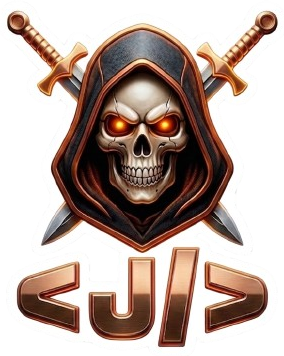

  

<h1 align="center">Jonathan Nava Noguez</h1>

<strong>Programador de videojuegos en formación · Unreal Engine · Unity</strong>

  
  
  
  

## Perfil

Soy estudiante de último año de Ingeniería en Programación de Videojuegos, con interés en construir mecánicas, sistemas interactivos y experiencias de gameplay. Trabajo principalmente con **Unreal Engine** y **Unity**, combinando programación, diseño de niveles y una mentalidad de mejora continua.

Me motivan los retos técnicos propios del desarrollo de videojuegos: convertir una idea en una experiencia jugable, iterar a partir del feedback y mantener el código claro y sostenible.

## Enfoque técnico

  
  
  
  
  

| Área | Tecnologías y prácticas |
| --- | --- |
| **Motores** | Unreal Engine (C++ y Blueprints), Unity |
| **Programación** | C++, C#, Java, Python, HTML y CSS |
| **Gameplay** | Control de personajes, sistemas de combate, objetos interactivos, UI/HUD y gestión de escenas |
| **Sistemas en Unreal** | Colisiones, triggers, inventarios, Chaos, widgets, RPCs y sincronización cliente-servidor |
| **Herramientas** | Git, GitHub, Visual Studio Code, Rider y Docker |
| **Forma de trabajo** | Programación orientada a objetos, principios SOLID, colaboración y aprendizaje continuo |

## Proyectos destacados

### Juego de plataformas 2D · Unity

Proyecto centrado en mecánicas de salto, físicas y diseño de niveles desafiantes.

[Ver gameplay](https://www.youtube.com/watch?v=KrHkZYZzGuA)

### Museo Artístico / VFX · Unity y Unreal Engine

Exploración de efectos visuales con sistemas de partículas y **Niagara**.

[Código del proyecto](https://github.com/IPV1412/VFX_Examen) · [Demo de Niagara](https://www.youtube.com/watch?v=KrHkZYZzGuA) · [Demo del museo](https://www.youtube.com/watch?v=GbS3k0F6iTw)

### Experiencias multijugador · Unreal Engine 5.4 y 5.5

Implementación de sistemas multijugador, sincronización y lógica de red para experiencias de juego.

[Código del proyecto](https://github.com/IPV1412/Ipvmulti) · [Ver demostración](https://www.youtube.com/watch?v=EonzClbbhqU)

> Encuentra más contexto y material visual de estos proyectos en el [portafolio web](https://ipv1412.github.io/Portafolio/).

## Experiencia y formación práctica

- **Supernova Dev Game** — participación en una Game Jam: desarrollo de gameplay en Unity, colaboración con el equipo y creación de una demo funcional dentro de un plazo limitado.
- **Proyectos personales** — creación de sistemas de gameplay y mecánicas básicas en Unreal Engine, además de trabajo con MetaHumans.
- **Formación en Unreal Engine** — personajes e inputs, UI/HUD con C++ y Blueprints, objetos interactivos, sistemas de juego y fundamentos de multijugador.
- **Formación en Unity** — control de jugador, combate, IA básica, UI/HUD y gestión del flujo del juego con `SceneManager`.

## Aprendizaje continuo

Mantengo una formación activa en desarrollo de videojuegos, inteligencia artificial y optimización de rendimiento. El portafolio documenta formación complementaria en *Deep Learning*, desarrollo con IA y actividades de comunidad como TalentLand.

## Contacto

- Portafolio: [ipv1412.github.io/Portafolio](https://ipv1412.github.io/Portafolio/)
- Itch.io: [overlord-jnn.itch.io](https://overlord-jnn.itch.io/)
- LinkedIn: [Jonathan Nava Noguez](https://www.linkedin.com/in/jonathan-nava-61b568384)
- Correo: [nn_Jonathan@hotmail.com](mailto:nn_Jonathan@hotmail.com)
- Ubicación: México

---

  Abierto a colaborar en proyectos de desarrollo de videojuegos y experiencias interactivas.

